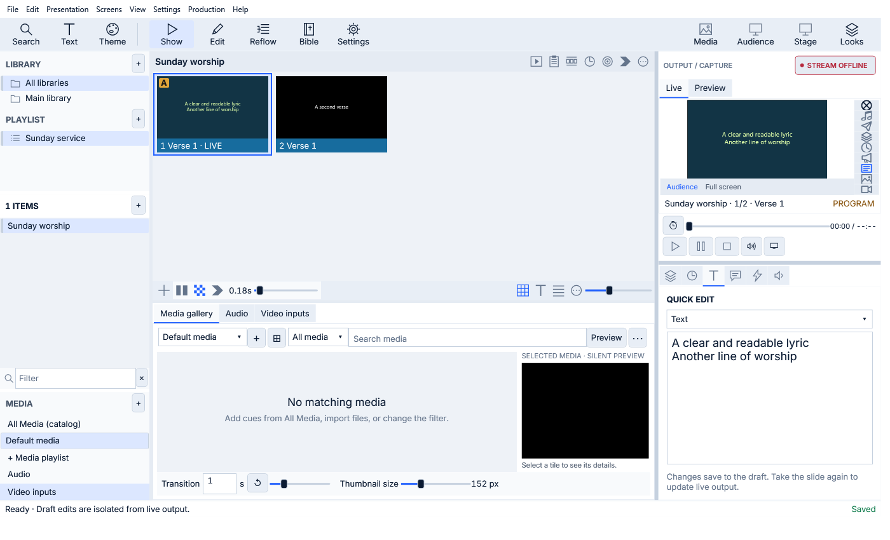

  

<h1 align="center">Salonaut</h1>

<strong>Create. Present. Go Live.</strong>

Church presentation and live-production software for Windows.

  <a href="https://github.com/fredybangs/salonaut/releases/latest"><strong>⬇ Download the latest version</strong></a>
  ·
  <a href="#install">Install</a>
  ·
  <a href="#your-first-service">First service</a>
  ·
  <a href="#troubleshooting">Troubleshooting</a>

Powered by <a href="https://thespaceman.tech">The SpaceMan</a>

---

Salonaut puts everything a Sunday service needs into one window: **song lyrics, Scripture, videos and images, cameras, lower thirds and scrolling text, timers, an audience screen and a stage screen, local recording, and live streaming to Facebook, YouTube or any RTMP service**. You build the service in advance, then run it live from the operator's screen, or from a phone.

It is free to download and use. It runs on Windows 10 and 11 (64-bit) and installs completely offline: no .NET, codecs or extra media software to set up.

> **Preview software.** Salonaut is in active development and has been used for real services, but every church's computer, cameras and network are different. **Rehearse on your own equipment before going live.** Updates arrive automatically (see [Updates](#updates)).

<picture>
  <source media="(prefers-color-scheme: dark)" srcset="images/salonaut-dark.png">
  
</picture>

Screenshots use sample content. The interface follows Windows' dark or light setting, or can be set by hand.

## Contents

- [What it does](#what-it-does)
- [System requirements](#system-requirements)
- [Install](#install)
- [Updates](#updates)
- [Your first service](#your-first-service)
- [Scripture](#scripture)
- [Media, cameras and NDI](#media-cameras-and-ndi)
- [Props, lower thirds and scrolling text](#props-lower-thirds-and-scrolling-text)
- [Streaming and recording](#streaming-and-recording)
- [Phone remote](#phone-remote)
- [Keyboard shortcuts](#keyboard-shortcuts)
- [Your data and backups](#your-data-and-backups)
- [Privacy](#privacy)
- [Troubleshooting](#troubleshooting)
- [Licences and credits](#licences-and-credits)

## What it does

| Area | What you get |
| --- | --- |
| **Service planning** | Libraries for songs and presentations, playlists with section headers, drag-and-drop ordering, search, and arrangements that repeat groups (verse, chorus, bridge…) in any order. |
| **Lyrics and slides** | Paste lyrics and they split into grouped slides automatically (`[Verse 1]`, `[Chorus]`…). Themes, transitions, group hotkeys, thumbnails and slide notes. |
| **Slide editor** | A canvas with rulers, guides, layers, text, shapes, images and video, plus a Shape / Text / Build inspector for fonts, outlines, shadows, alignment and object animations. |
| **Themes** | Reusable layouts, including transparent lower thirds for streaming, with previews before you apply them. |
| **Scripture** | Offline Bibles with reference and keyword search (`John 3:16`, `Psalm 23`, "love is patient"), themed verse slides, and save-as-presentation. |
| **Media** | Video, audio and image playlists, play/pause/stop and a seek bar, loop and volume, drag-and-drop import. Media plays under your slides, so lyrics stay on top of a background video. |
| **Cameras and inputs** | USB cameras and capture cards with automatic format detection, NDI sources from other computers, and reconnection when a camera is unplugged and plugged back in. |
| **Production tools** | Props (logos, lower thirds, scrolling tickers), audience and stage messages, countdown and clock timers, macros, and Looks that choose which layers each screen shows. |
| **Screens** | Separate audience and stage windows, a Live and Preview monitor, and one-click clearing of each layer (slides, media, camera, props, messages, audio). |
| **Streaming and recording** | Several RTMP/RTMPS destinations at once with adaptive bitrate, local recording that carries on if something goes wrong, and NDI output to OBS or other tools. |
| **Phone remote** | Run the service from a phone on the church Wi-Fi: slides, playlists, Bible, media, cameras, props, clear layers, and a live picture. |
| **Migration** | Import ProPresenter 7 libraries (with a report of anything that couldn't be converted), PowerPoint files, and portable Salonaut bundles. |

Edits you make while a slide is live never change what the congregation sees until you take that slide again, so you can fix a typo safely mid-service.

## System requirements

| You want to… | Processor | Memory | Graphics |
| --- | --- | --- | --- |
| Show slides on an audience screen | Modern 4-core 64-bit CPU | 8 GB | Any DirectX 11 graphics |
| Also stream two 720p services | 6-core / 12-thread CPU | 16 GB | Hardware video encoding (NVIDIA NVENC, Intel Quick Sync or AMD AMF) |
| Stream two 1080p services **and** record | 8-core / 16-thread desktop CPU or better | 32 GB | Hardware encoder with room for three encodes; a dedicated GPU with 6 GB is comfortable |

- **Windows 11 (64-bit)** is recommended. Windows 10 64-bit also works.
- An **SSD**, at least **2 GB free** for the program, plus space for your media. Allow **3–4 GB per hour** of recording.
- A **second display output** for the audience screen (and a third for a separate stage screen).
- For streaming, use **wired Ethernet**. A rough guide for upload speed is 1.5 × the total bitrate of all your destinations. Two streams at 4 Mbps each need **at least 15 Mbps upload**; two at 6 Mbps need about 25 Mbps.

These are planning targets, not guarantees. Laptops in particular slow down under long, heavy loads. Always do a full-length rehearsal.

## Install

1. Open the **[latest release](https://github.com/fredybangs/salonaut/releases/latest)** and download `Salonaut-Setup-<version>-win-x64-offline.exe`.
2. Run it under the Windows account that will operate the services. Tick **Create a desktop shortcut** on the last page if you want one.
3. Open **Salonaut** from the Start menu or the desktop.

**"Windows protected your PC"?** The installer is not yet code-signed, so Windows SmartScreen may warn you the first time. Choose **More info → Run anyway**. Only do this for files you downloaded from this page.

The installer includes everything Salonaut needs: the .NET runtime and the FFmpeg media engine for cameras, recording and streaming. Two things are optional:

- **NDI** (sending or receiving video over the network): use **Start menu → Salonaut → Set up NDI support** to install the official NDI runtime, then restart Salonaut.
- **Fonts:** Salonaut's interface prefers Inter and Montserrat and falls back to Segoe UI. Fonts used in your slides must be installed on the computer that presents them.

**Uninstalling** (Windows Settings → Apps) removes the program but keeps your presentations, Bibles, media and settings.

## Updates

Salonaut checks this page for a new version once a day, and whenever you choose **Help → Check for updates**.

- You see what's new before anything is installed.
- **Updates are refused while you are streaming, recording, sending NDI or showing the audience screen**, so a service is never interrupted.
- The download is checked against its published SHA-256 fingerprint, and a file that doesn't match is deleted, never run.
- Salonaut saves your work, installs quietly and reopens. Your content is not touched.

You can turn this off with **Help → Check for updates automatically**.

## Your first service

1. **Create a song.** Press **Ctrl+N** (File → New presentation), give it a name and paste the lyrics. Headings in square brackets such as `[Verse 1]` and `[Chorus]` become groups, and blank lines start a new slide.
2. **Pick a theme.** Choose one when creating the song, or later with **Theme** on the toolbar.
3. **Build the playlist.** Drag songs, Bible passages and media into a playlist in service order and add section headers ("Worship", "Sermon", "Announcements").
4. **Set up the screens.** Open **Settings → Configure screens** and assign the Audience (and Stage) output to the right display. Turn on **Audience** in the top bar.
5. **Go live.** Click a slide to send it to the screen. Space, Page Down or a presentation clicker goes forward; Page Up goes back. The **Live** monitor always shows what the congregation sees.
6. **Clear when needed.** Use the clear buttons beside the Live monitor (or **F1–F7**) to remove slides, media, camera, props, messages or audio, or press **.** (full stop) to black out the screen.

Rehearse the whole service once with your real displays, cameras, sound and stream before Sunday.

## Scripture

Open **Bible** on the toolbar.

- **Add Bibles** in the Bible Manager:
  - import USX, USFM, OSIS, CSV or ZIP Bible files you're permitted to use;
  - install free public-domain translations from the built-in catalogue;
  - connect an API.Bible or YouVersion account for online passages.
- **ProPresenter Bible files:** Salonaut can download the free community *Bible converter* tool for you in one click (from [propresenter-custom-bibles](https://github.com/martijnlentink/propresenter-custom-bibles)). It's checked against a known fingerprint before use.
- **Find a passage** by reference (`Romans 8:28-39`) or by words, choose a theme, and click a verse to put it on screen. Turn on **Preview** to stage verses before they go live.
- **Save** a passage as a presentation or add it to the playlist.

Salonaut does not include any copyrighted Bible translations. Check each translation's licence before installing or displaying it.

## Media, cameras and NDI

- **Import** videos, audio and images by dragging files onto Salonaut or into the media gallery. They're copied into Salonaut's own storage, so moving the originals doesn't break your service.
- **Media playlists** keep walk-in music, announcement loops and sermon clips in order. Play/pause, stop, seek, loop and volume are on the transport bar.
- **Cameras:** add USB cameras, capture cards and NDI sources under **Video inputs**, preview them, then take them live. The camera sits behind your slides, so lyrics and lower thirds stay on top. A camera that is unplugged and reconnected comes back on its own.
- **NDI out:** send the program picture to OBS (with the DistroAV plugin) or other NDI tools. A low-bandwidth option helps on Wi-Fi.

## Props, lower thirds and scrolling text

Props are overlays that stay on screen while slides change: a logo bug, a speaker's name, a "Welcome" banner or a scrolling announcements ticker.

- Right-click the **Props** panel and choose **New Prop…** or **New scrolling text…**. Click a prop to show or hide it.
- Scrolling text can move in any direction, at any speed, with soft faded edges, and can read its text from a file or RSS feed so you can update announcements without editing slides.
- Choose per prop whether it appears on the audience screen, the stream, or both.

## Streaming and recording

Open **Settings → Stream settings…**.

1. **Add destinations:** Facebook, YouTube or any custom RTMP/RTMPS server, using the server URL and stream key from the platform. Several can run at once.
2. **Pick your audio**, for example a Focusrite or other USB mixer interface. Video and audio clips are mixed into the stream automatically.
3. **Pick the encoder.** **Auto** uses your graphics card's hardware encoder when it is available and falls back to the CPU otherwise.
4. **Go live** from the Output / Capture panel and watch each destination's status and bitrate. If the connection gets congested, Salonaut lowers that destination's bitrate to keep the stream close to live, without affecting the others.
5. **Record** at the same time, to MKV or MP4. If the recording is interrupted, it continues in a new part file (`Service-part2.mkv`…) instead of stopping.

Stream keys are only saved if you choose to remember them, and then they're protected by Windows for your account. They're never included in exports. A "connected" status means Salonaut is sending; always check the platform's own live preview to confirm the broadcast is public.

## Phone remote

Run the service from any phone or tablet on the same Wi-Fi network, with no app to install.

1. In Salonaut choose **View → Phone remote…** (or click the phone icon in the top bar) and press **Start**.
2. Scan the QR code with the phone's camera. It opens a web page that is already paired.
3. From the phone you can:
   - see the live picture and the next slide;
   - change slides, browse playlists and songs;
   - search the Bible and put verses on screen;
   - take media and cameras live, show and hide props;
   - clear layers, and watch audio levels and stream health.

The remote only accepts phones that scanned the current pairing code. **Forget paired phones** issues a new code. The default port is 17971; if Windows Firewall asks, allow Salonaut on **private** networks.

## Keyboard shortcuts

| Key | Action |
| --- | --- |
| Space · Page Down · → | Next slide (presentation clickers work) |
| Page Up · ← | Previous slide |
| . (full stop) | Black out / restore the screen |
| F1 | Clear everything |
| F2 / F3 / F4 | Clear slides / media / audio |
| F5 / F6 / F7 | Clear props / message / camera |
| A · S · D · F / C | Jump to Verse 1–4 / Chorus (changeable) |
| Ctrl+N | New presentation |
| Ctrl+F | Search |
| Ctrl+S | Save and back up |
| Ctrl+Enter | Take the selection live |
| Ctrl+Z / Ctrl+Y | Undo / redo |
| Ctrl+Shift+T / P / C | Themes / Props / Timers |
| Shift+Esc | Turn the audience screen off (when it has focus) |

## Your data and backups

Everything you create lives in **`%LOCALAPPDATA%\ChurchPresenter`** (paste that into File Explorer's address bar):

| Item | What it is |
| --- | --- |
| `library.db` | Songs, presentations, playlists, themes, props and settings |
| `bibles.db` | Installed Bibles and search index |
| `media\` | Your imported videos, audio and images |
| `backups\` | Automatic backups. Salonaut can recover from them if a database is damaged |
| `errors.log` | Details of any error Salonaut caught (useful when reporting a problem) |

- **Ctrl+S** saves and makes a backup. Salonaut also saves automatically as you work.
- To move to another computer, use **File → Export** (a portable bundle that includes your media) and **File → Import** on the new PC.
- Close Salonaut before copying the folder by hand.

## Privacy

Salonaut has no accounts, adverts, analytics or tracking. It only goes online when:

- it checks this page for updates (you can turn that off);
- you install or search a Bible from an online provider you chose;
- you download the optional Bible converter;
- you stream to the destinations you configured.

The phone remote works only on your local network.

## Troubleshooting

| Problem | Try this |
| --- | --- |
| "Windows protected your PC" when installing | **More info → Run anyway** (the installer is not yet code-signed). |
| Audience screen opens on the wrong monitor | **Settings → Configure screens**, pick the display, then turn Audience off and on. |
| Camera shows black or "unavailable" | Close other apps using the camera (Zoom, Teams, OBS), then click **Preview** again. Check the camera works in the Windows Camera app. |
| USB audio interface missing after reconnecting | Plug it back in and wait a few seconds. Salonaut picks it up again without restarting. |
| Stream keeps reconnecting or lags | Use wired Ethernet, lower the bitrate or resolution, and choose a hardware encoder. Check your upload speed against [the guide above](#system-requirements). |
| Phone remote won't connect | Phone and computer must be on the same Wi-Fi. Allow Salonaut through Windows Firewall on private networks, and rescan the QR code. |
| Video has no sound or won't play | Check the clip plays in the Windows Media Player app. Install the codec for unusual formats or convert the file to MP4 (H.264/AAC). |
| Salonaut shows "caught an error and kept running" | Your service can continue. Afterwards, send the latest part of `errors.log` (see [Your data](#your-data-and-backups)) with your report. |

**Reporting a problem:** open an [issue](https://github.com/fredybangs/salonaut/issues) and include:

- your Salonaut version (**Help → About Salonaut…**);
- your Windows version;
- what you were doing;
- the relevant lines of `errors.log`.

Please **never post stream keys, passwords or your whole data folder**.

## Licences and credits

Salonaut is free of charge. It bundles or uses:

- **FFmpeg / FFprobe** for camera capture, recording and streaming. The included build contains GPL components (libx264). Licence and source information are installed with Salonaut under `MediaRuntime`.
- **NAudio** (MIT), **Microsoft.Data.Sqlite** and **SQLitePCLRaw**. Their licence texts are in the `Licenses` folder of the installation.
- **NDI®** is a registered trademark of Vizrt NDI AB. The NDI runtime is installed separately, under its own licence.
- **Bible translations, song lyrics, media and fonts** you add keep their own copyright. Make sure your church is licensed to display and stream them (for example through CCLI).

ProPresenter, OBS Studio, Facebook and YouTube are trademarks of their respective owners. Salonaut is independent software and is not affiliated with or endorsed by them.

Salonaut · Create. Present. Go Live. · Powered by <a href="https://thespaceman.tech">The SpaceMan</a>

